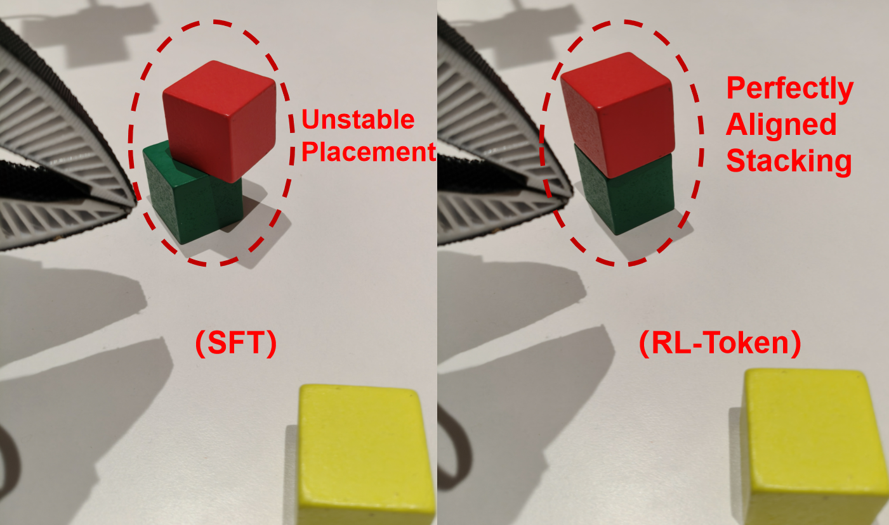
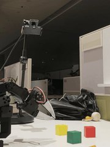
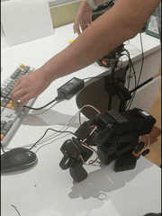
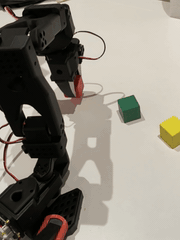
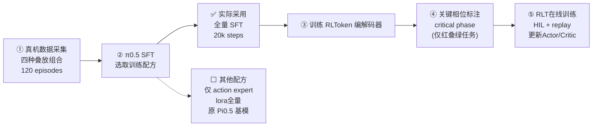

# 🦾 RLToken × π0.5 × SO-101

**目标：**用四种颜色组合的 120 集示范训练 π0.5，再针对**红块叠绿块并对齐**，在 SO-101 上进行 RLToken 的人工介入在线训练。Windows 控制真机；Linux GPU 运行推理与学习。

| SFT vs RLT | SFT (OOD Position) 抬起不够高、放不稳、松开碰掉 | RLT Human-In-Loop | RLT 推理 足够高、对齐后放置 |
| :---: | :---: | :---: | :---: |
|  |  |  |  |

pick-and-place 成功率：**全量SFT** 76.7% (23/30)；**lora全量微调** 80% (24/30)；**仅action expert训练** 10% (3/30)。
place 时完美对齐率：**全量SFT** 偶然 6.7% (23/30)；**RL-Token** 76.7% (23/30) 。

SFT 训练时红绿黄的方块同时存在，仅使用4种颜色组合，测试时确认模型学到另两种颜色组合的泛化性。
RLToken 在单颜色组合任务训练后，仍然能够保其他颜色组合的泛化性（但三色方块共存时偶尔会放错方块）。

## 🗺️ 一图看懂五阶段

## 🧭 从哪里开始

| 想做的事 | 操作入口 |
| --- | --- |
| 📸 原始 SFT 配方、环境、权重及 Windows 真机部署 | [π0.5 SFT 操作手册](SFT-操作手册.md) |
| 🧬 30 集编码器、单跨度关键区间、在线示教与评估 | [RLToken 在线训练操作手册](RLT-操作手册.md) |
| 🔌 6016 消息、动作单位、replay 约定 | [在线协议](PROTOCOL.md) |

## 🧰 Preparation

- 📦 **数据：**`BlossomsGarden/pick-and-place-v3_20261025_051506`（120 集、四种颜色）；Stage ③/④ 仅用红块叠绿块的 episode 0–29；关键相位标注为单跨度 JSON。
- 🧠 **SFT：**原服务器的 20k π0.5 checkpoint 与同源 q01/q99 stats；本仓库含配方注册、模型转换和分离式部署，原机的实际训练启动命令需核验。
- 🖥️ **服务器：**JAX SFT 环境跑 6006；独立 Python 3.12 / CUDA PyTorch 环境跑 6016，依赖见 [requirements-ssh.txt](requirements-ssh.txt) 与本地 `lerobot/`。
- 🦾 **Windows：**LeLab GUI 既有 `.venv` + [requirements-client.txt](requirements-client.txt)；将两个 6006/6016 WebSocket 端口经 SSH 转发至本机回环。
- 🛡️ **替换臂：**6006 启动时使用 `--new-so101` 和已验收的映射文件；6016 使用同一份 `configs/joint_mapping.json`。Windows 从臂一律 `--no-calibration`，不要重刷固件标定；`configs/robot.json` 的限位与核验标志必须实测填写。

## 🔎 运行顺序

1. **SFT 先通：**按 [SFT 手册](SFT-操作手册.md)启动 6006，Windows 经 SSH 隧道运行 `python test_so101_inference.py --host 127.0.0.1 --port 6006`、核对双摄、无动作 dry-run，然后再开 `--execute`。
2. **离线资产：**按 [RLT 手册](RLT-操作手册.md)准备同源 PyTorch π0.5、红叠绿 30 集、编码器与 Stage 4 分类器；Stage 4 自动识别可由在线 `c` 键手动切换，但模型文件仍须满足现有配置的加载要求。
3. **在线采集与训练：**服务器 `bash start_brain.sh`；Windows 经 6016 隧道先 `python deploy_rlt.py --no-calibration`，安全验收后运行 `python deploy_rlt.py --no-calibration --execute --no-replan-every-window --no-auto-critical`。该平滑模式连续执行 50 步 VLA；`h/s` 接管纠错、`c` 标关键相位，后台照常训练。
4. **切入 Actor 与评估：**若要执行 Actor，去掉 `--no-replan-every-window`，并在客户端按 `a` 开启；服务端仍要求 ≥5 集有关键 transition、replay ≥256、更新 ≥1000、关键期持续 ≥20 步。实际操作建议先积累约 30 集关键示教，再按 `a`；看 `metrics.jsonl`，另做无人接管对照评估。

**动作约定：**SFT π0.5 的前五轴为以 chunk 起点观测为基准的 delta，夹爪绝对值；服务器转换为 SO-101 从臂绝对目标。Actor 仅在操作员开启并满足服务端门槛后，于逐窗重规划模式修正关键 10 步。训练代码使用双 Q、目标动作噪声和 `10×BC−Q`，**不能直接称为标准 SAC**。详细消息字段和数据边界见 [PROTOCOL](PROTOCOL.md)。
