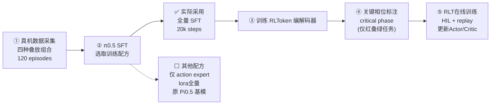

# 🦾 RLToken × π0.5 × SO-101

**目标：**用四种颜色组合的 120 集示范训练 π0.5，再针对**红块叠绿块并对齐**，在 SO-101 上进行 RLToken 的人工介入在线训练。Windows 控制真机；Linux GPU 运行推理与学习。

## 🗺️ 一图看懂五阶段

## 🧭 从哪里开始

| 想做的事 | 操作入口 |
| --- | --- |
| 📸 原始 SFT 配方、环境、权重及 Windows 真机部署 | [π0.5 SFT 操作手册](pi05-SFT-操作手册.md) |
| 🧬 30 集编码器、单跨度关键区间、在线示教与评估 | [RLToken 在线训练操作手册](RLT-操作手册.md) |
| 🔌 6016 消息、动作单位、replay 约定 | [在线协议](PROTOCOL.md) |

## 🧰 Preparation

- 📦 **数据：**`BlossomsGarden/pick-and-place-v3_20261025_051506`（120 集、四种颜色）；Stage ③/④ 仅用红块叠绿块的 episode 0–29；关键相位标注为单跨度 JSON。
- 🧠 **SFT：**原服务器的 20k π0.5 checkpoint 与同源 q01/q99 stats；本仓库含配方注册、模型转换和分离式部署，原机的实际训练启动命令需核验。
- 🖥️ **服务器：**JAX SFT 环境跑 6006；独立 Python 3.12 / CUDA PyTorch 环境跑 6016，依赖见 [requirements-ssh.txt](requirements-ssh.txt) 与本地 `lerobot/`。
- 🦾 **Windows：**LeLab GUI 既有 `.venv` + [requirements-client.txt](requirements-client.txt)；将两个 6006/6016 WebSocket 端口经 SSH 转发至本机回环。
- 🛡️ **更换真机机械臂：**设置 --new-so101 机械臂，专门针对训练数据收集机器与推理机器不同的情况设计。但是请注意，一定要两个机器的标定文件都存在。替换臂的关节映射 `configs/joint_mapping.json` 与 `configs/robot.json` 安全标记/物理限位必须先由实测填写。

## 🔎 运行顺序

1. **SFT 先通：**按 [SFT 手册](pi05-SFT-操作手册.md)启动 6006，Windows 经 SSH 隧道运行 `python test_so101_inference.py --host 127.0.0.1 --port 6006`、核对双摄、无动作 dry-run，然后再开 `--execute`。
2. **离线资产：**按 [RLT 手册](RLT-操作手册.md)准备同源 PyTorch π0.5、红叠绿 30 集、编码器与 Stage 4 分类器；Stage 4 自动识别可由在线 `c` 键手动切换，但模型文件仍须满足现有配置的加载要求。
3. **在线训练：**服务器 `bash start_brain.sh`；Windows 经 6016 隧道先 `python deploy_rlt.py --no-calibration`，确认映射和首步安全后执行 `python deploy_rlt.py --no-calibration --execute --no-replan-every-window --no-auto-critical`。
4. **检查效果：**每集按 `f` 后确认 `y/n` 终局奖励，人工纠错按 `h/s`；区分自主与人工救回的成功。用 `rlt_episodes/` 和 `outputs/rlt_online/metrics.jsonl` 检查收集/学习，独立运行无人接管对照评估。

**动作约定：**SFT π0.5 的前五轴为以 chunk 起点观测为基准的 delta，夹爪绝对值；服务器转换为 SO-101 从臂绝对目标。在线 Actor 在关键 10 步窗口修正；训练代码使用双 Q、目标动作噪声和 `10×BC−Q`，**不能直接称为标准 SAC**。详细消息字段和数据边界见 [PROTOCOL](PROTOCOL.md)。
