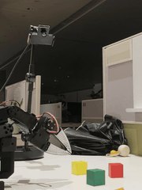
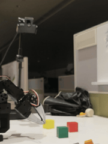

# 🧪 π0.5 SFT 操作手册

从 **120 集、四种颜色指令**的 SO-101 双摄数据出发，完成 π0.5 全参数 SFT，并在 Windows 真机与 Linux GPU 服务器间部署 20k step checkpoint。五阶段路线见 [总 README](README.md)；RLToken 在线环节见 [RLT 操作手册](RLT-操作手册.md)。

## 🗺️ 模型分布式部署

```text
┌──────────────────────────────────────────────────────────────┐
│ 本地主机：Windows                                             │
│ SO-101 + LeRobot 0.6.0 / LeLab .venv                         │
│                                                              │
│ 真机双相机图像 + SO-101 从臂 6 维状态 + 任务指令               │
│                         ↓                                    │
│ 观测采集 → RGB / JPEG 编码 → OpenPI WebSocket 客户端           │
│                                      ↑                       │
│                             接收 H50×6 绝对目标动作           │
│                                      ↓                       │
│                    时效 / 范围 / 关节限速 / 跟踪误差检查        │
│                                      ↓                       │
│                       LeRobot → USB 串口 → SO-101 从臂        │
│                                                              │
│ 无硬件测试：合成图像与状态 → 同一客户端 → 模拟执行器             │
└────────────────────┬────────────────────▲────────────────────┘
                     │                    │
                     │ JPEG 双相机         │ H50×6 动作序列
                     │ 6 维状态 / 指令     │ 推理耗时
                     ▼                    │
           SSH 本地转发：127.0.0.1:6006 → 服务器 127.0.0.1:6006
                     │                    ▲
                     │ WebSocket / MessagePack
                     ▼                    │
┌──────────────────────────────────────────────────────────────┐
│ 远程服务器：Linux（训练 4×H200；部署时加载 SFT checkpoint）   │
│ OpenPI JAX 环境 / π0.5 / serve_policy_fixed_noise.py          │
│                                                              │
│ JPEG 解码 → SO-101 输入转换 / 归一化 → GPU 模型推理             │
│                                      ↓                       │
│                  反归一化 / 恢复绝对目标 → 返回 H50×6 动作     │
│                                                              │
│ checkpoint：红块叠绿块等四种组合的 SFT 20k step              │
│ 模型调用链不经过 ROS2 / MuJoCo 容器                            │
└──────────────────────────────────────────────────────────────┘
```

## ⚗️ 环境配方

- 🖥️ 服务器 SFT：沿用原有 **OpenPI JAX** 环境、训练权重和原 checkpoint；安装本仓库的 [requirements-ssh.txt](requirements-ssh.txt)。RLToken 的 PyTorch 环境另行使用，见 [RLT 手册](RLT-操作手册.md)。
- 🦾 Windows：沿用 LeLab GUI 的 `.venv` 环境，安装 [requirements-client.txt](requirements-client.txt)；本仓库根目录下的 `deploy_openpi.py`、`test_so101_inference.py`、`check_camera.py`、`sft/` 等文件保持相对目录结构。
- 📦 数据：`BlossomsGarden/pick-and-place-v3_20261025_051506`，共 120 集、四种颜色组合；基础模型为 OpenPI `pi05_base`。私有数据、SFT checkpoint 与原训练脚本不包含在本仓库。
- 🔧 标定：从臂使用与采集时对应的标定；换臂时先核实 `configs/joint_mapping.json` 和真实关节/夹爪安全边界。

## 🧪 SFT 配方

以下是本仓库采用的**独立 20k 步全量 SFT 配方**；`sft/so101_config.py` 注册配置，`sft/openpi_entry.py` 提供训练入口。当前 20k 配置保留，不按 OCR 报告中的另一训练进度修改衰减步数。

| 模块 | 实际使用配置 |
| --- | --- |
| 计算与优化 | 4×H200 数据并行；每卡 batch 4、global batch 16；workers 8；AdamW、梯度裁剪 `1.0`；warmup 1000 步升至峰值 `2.5e-5`，按当前配方在 20k steps 内 cosine 衰减至 `2.5e-6` |
| 可训练参数 | **全参数微调**：视觉与 PaliGemma 语言部分也参与；EMA `0.999` 覆盖全参数 |
| 动作 | 前五关节为相对**生成该 chunk 时观测 state** 的 delta；夹爪是绝对目标；动作与相机对齐至 30 fps；q01/q99 归一化 |
| 相机 | 外置视角 → `base_0_rgb`；腕部视角 → `left_wrist_0_rgb`；`right_wrist_0_rgb` 的 mask 全 0；原始 640×480 等比缩放至 168×224，再上下各补 28 行黑边至 224×224 |
| 训练记录 | 每 10k steps 约 4 小时 26 分钟；显存约 110 GB（原训练机记录，非本仓库复测） |

**20k checkpoint** 是后续 Stage 3/4/5 冻结使用的 SFT 基础；10k 仅是训练耗时统计的单位，当前仓库没有可核验的 10k SFT 性能对照。Stage 3 的编码器训练、Stage 4 分类器训练与 SFT 全参数训练是不同步骤。

训练配置名为 `pi05_so101_pickplace_v3`，配方见 [sft/so101_config.py](sft/so101_config.py)；[sft/openpi_entry.py](sft/openpi_entry.py) 负责在原 OpenPI 环境注册配置后调用其训练和统计脚本。归一化统计要与选用的 20k checkpoint **同源**，不能用 LeRobot 数据集的绝对动作 q01/q99 代替 delta 动作统计。真机前需完成 [安全与性能验收](进一步确认的文档.md)。

## 👩‍🔬 分离式推理

### 1️⃣ 服务器启动 6006

在原 OpenPI 环境和本仓库根目录运行；按原服务器实际目录设置以下**相对路径或环境变量**：

```bash
export OPENPI_ROOT=../openpi
export SFT_CHECKPOINT_DIR=checkpoints/pi05_20k
# 更换 SO-101 且映射经真机核验时才设置：
# export NEW_SO101=1
# export MAPPING_FILE=configs/joint_mapping.json
bash sft/serve_so101.sh 6006
```

另开终端，从仓库根目录做**无机械臂**请求测试（服务只监听回环）：

```bash
python test_so101_inference.py --host 127.0.0.1 --port 6006 --prompt "Pick up the red block and place it on top of the green block."
# 预期：SMOKE TEST PASSED，返回有限值的 (50, 6) 动作
```

### 2️⃣ Windows 建立 SSH 隧道

先在 **工作区根目录**运行网络预检，然后打开隧道；`SSH_PORT`、`SSH_HOST`、`SSH_KEY` 在当前 PowerShell 会话中自行设置，**不要写入仓库**。隧道需一直保持开启。

```powershell
Push-Location ../..
powershell.exe -NoProfile -File .\Ensure-IWanRemote.ps1 -Connect
Pop-Location
ssh -p $env:SSH_PORT -L 9000:127.0.0.1:9000 -L 6006:127.0.0.1:6006 "root@$env:SSH_HOST" -i $env:SSH_KEY
```

通过 `http://localhost:9000/windows/` 下载 Windows 运行文件；保持 `sft/`、顶层入口及依赖目录的相对结构。从**本仓库根目录**继续：

```powershell
python test_so101_inference.py --host 127.0.0.1 --port 6006
```

### 3️⃣ 编辑 `.env` 并核对双摄

在根目录参考 [sft/.env.example](sft/.env.example)。端口、相机索引仅为示意，标定路径需按项目目录调整；不要把私人绝对路径或密钥提交到仓库：

```dotenv
FOLLOWER_PORT=COM5
FOLLOWER_ID=so101
FRONT_CAMERA=1
SIDE_CAMERA=0
CAMERA_WIDTH=640
CAMERA_HEIGHT=480
FPS=30
HF_LEROBOT_CALIBRATION=../sources/lelab-main/.cache/huggingface/lerobot/calibration
TASK_DESCRIPTION=Pick up the red block and place it on top of the green block.
OPENPI_HOST=127.0.0.1
OPENPI_PORT=6006
OPENPI_API_KEY=
```

`FOLLOWER_ID` 是 `calibration/robots/so_follower/` 下对应 JSON 文件的**不含扩展名**文件名。客户端也接受旧命名 `CAM_FRONT`／`CAM_SIDE`；同一视角两种名称同时设置时必须相同，否则拒绝启动。

```powershell
python check_camera.py
# 在当前目录生成 front.png、side.png；检查打印的索引与视角是否对应
```

训练时 **`front` 是外置相机**（`base_0_rgb`），**`side` 是腕部相机**（`left_wrist_0_rgb`）。每次插拔 USB 后序号可能重排，仍须打开 `front.png`、`side.png` 与训练帧实拍核对，不能只相信设备编号。

### 4️⃣ 先 dry-run，再执行

```powershell
python deploy_openpi.py --no-calibration --jpeg-quality 90 --steps 1 --execute-horizon 50 --prefetch-after 50 --fps 30
```

不带 `--execute`：采集图像与状态、请求动作、检查输出，但不发送运动命令。原 120 集首帧六维均值 `[-3, -103, 93, 55, 0, 0]` 仅供比对，当前臂标定与起始位姿仍需实机检查。

```powershell
# 完整 50/50：执行整块后停稳、重新观测
python deploy_openpi.py --no-calibration --jpeg-quality 90 --steps 1500 --execute-horizon 50 --prefetch-after 50 --fps 30 --execute --task "Pick up the red block and place it on top of the green block"

# 异步 RTC：执行 25 步，在第 15 步提前采样下一观测；前五轴重新锚定
python deploy_openpi.py --no-calibration --jpeg-quality 90 --steps 1500 --execute-horizon 25 --prefetch-after 15 --fps 30 --rebase-delta --execute --task "Pick up the red block and place it on top of the green block"
```

可按运行需要把 `--steps` 改为 2000；15/5 也是可试的 RTC 地平线／提前采样组合。异步预取下，前五轴 delta 以**发起那次请求时的观测 state** 为基准；`--rebase-delta` 才在执行下一段前按执行时 state 重锚定，夹爪绝对值不重锚定。

## 🎞️ SFT 在新位置的失效片段

| 方块换位后动作迟疑 | 首次伸臂过大，偏离示范分布 |
| :---: | :---: |
|  |  |

- **新位置：**换了方块起始位置后，抓取与放置过程出现反复试探，抬起高度和稳定性不足。
- **偏离轨迹：**第一次伸臂幅度过大后进入训练分布外（OOD）状态，SFT 难以靠后续动作自行修正，可能卡住。这两段视频是具体案例，不代表统计成功率。

## ⏱️ 性能记录与排查

- 用户提供的原机记录：PyTorch fp32 约 22 GB／184 ms；JAX fp16 约 8.8 GB／85 ms；相机读数/编码约 10 ms、网络估计约 20 ms、返回动作约 5 ms，合计约 120 ms。**这些并非本仓库或当前隧道复测值**。
- 50 步、30 fps 的一块覆盖约 1.67 s；整体停顿还受 `settle` 影响。现有 SFT 客户端在下一次抓拍前要求连续 **4 次**、每次间隔约 **50 ms** 的关节运动不超过 0.5°；实际端到端时间需看日志和真机测量。
- 机械臂发生跟踪误差、夹爪打滑或镜头错位时，停止执行并复核安全阈值、标定和映射。待做的本地实测见 [安全与性能验收](进一步确认的文档.md)。
